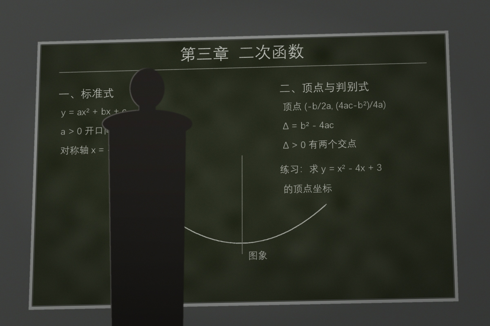
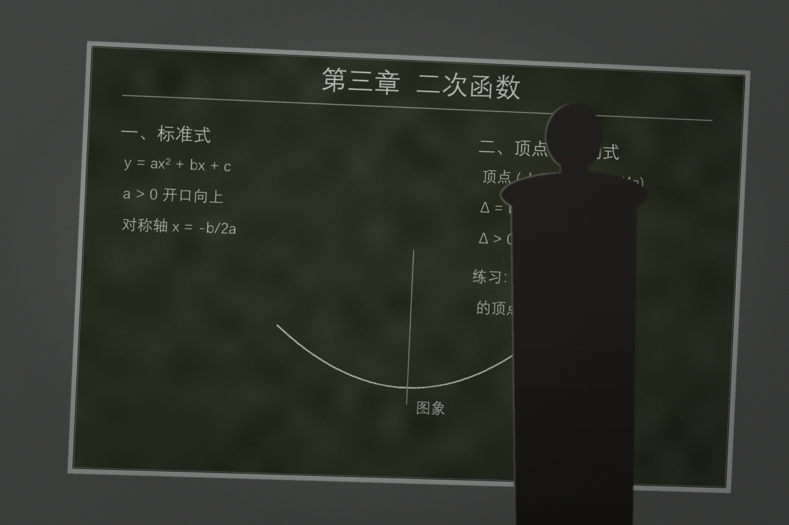
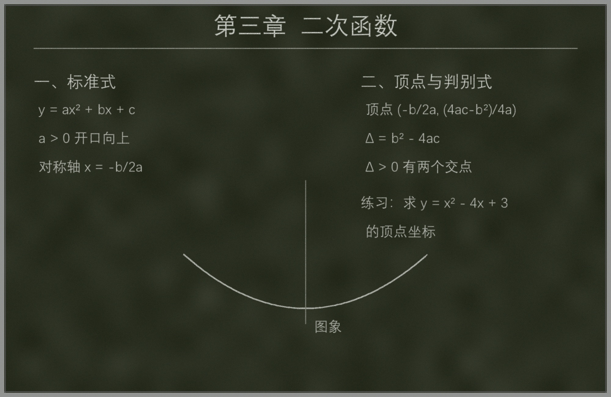

# 遮不住 Unblock

用另一张照片里本来就看得见的像素，把被挡住的黑板补回来。

不是 AI 生成，也不是 inpainting。

| 第一张 | 第二张 | 合成结果 |
|---|---|---|
|  |  |  |

## 它解决什么

上课、讲座、培训时拍板书，总会有人站在前面挡住一块。

你换个位置再拍一张，挡住的地方就换了。两张合起来，每一处至少有一张是看得见的。

这个 App 做的就是这件事：把第二张里那些被第一张挡住、但本身清晰可见的像素，搬到第一张上。

## 核心命题

**用真实像素救回内容，不用生成式补全。**

这条约束带来两个直接结论：

- 补齐的每一个像素，都来自另一张照片里真实存在的内容，不是猜的
- 两张都被挡住的地方，补不回来。这是物理上限，不是 bug

App 会在补不回来时说清原因，而不是给一张看似完整、实际是编出来的图。

## 功能

**输入**

- 相册多选 2–4 张，系统 Photo Picker，无需存储权限
- 相机直拍
- 自动选基：按遮挡占比、清晰度、正对程度、曝光四项打分，不需用户决定「哪张当底图」

**处理**

- 平面检测多策略：暗色线段、亮色线段、亮色轮廓、内缩兜底，纸张和白板同样适用
- 对齐：SIFT + RANSAC，失败时依次退到相位相关与四角单应；再叠加网格化残余位移精修
- 遮挡判定：贴边、与前景语义相交、画面内部实心色块三条证据取或，并单独识别人物投在板面上的半影
- 融合：逐连通块多源评估、增益补偿、距离场羽化
- 正视校正：把倾斜拍摄的黑板拉成矩形

**输出**

- 自动存入最近任务，可回看
- 保存到相册（Pictures/Unblock）
- 质量闸门：覆盖不足、盲区过高、内容已变化、对齐失败时不出图，直接给可执行的建议

## 使用

1. 打开 App，点唯一那个加号
2. 选同一块黑板的 2–4 张照片，**遮挡位置要不同**
3. 确认四角。App 会自动定位，你只需要拖一下贴住黑板边缘，大概准就行
4. 等待约 4 秒
5. 保存到相册

三条容易踩的坑：

- 拍照之间不要擦黑板或翻页，内容一变整条链路就失效
- 机位角度别差太大，差太远重采样会糊，字看不清
- 两张都挡住同一块区域，那块就补不回来

## 首次使用

App 内置三步聚光引导，依次高亮首页入口、四角手柄、保存按钮，点一下即可继续。

失败时页面底部有「看示例」，用一组真实板书照片演示原理和边界。

## 技术栈

| 端 | 组成 |
|---|---|
| Android | Kotlin、OpenCV 4.10.0、ONNX Runtime 1.19.2、YOLOv8n-seg 分割，无 NDK |
| PC | Python 算法管线，用于参数标定、真机一致性回归与批量验证 |

两端共用同一份 `config.json` 参数，键名一致，避免双端行为漂移。

## 构建

环境：JDK 17、Android SDK 34、Gradle 8.9。

```powershell
$env:JAVA_HOME='<jdk-17 路径>'
$env:ANDROID_HOME='<android-sdk 路径>'

& '<gradle 路径>\bin\gradle.bat' assembleDebug --offline --console=plain
```

安装：

```powershell
adb install -r android/app/build-app/outputs/apk/debug/app-debug.apk
```

注意 Gradle 增量构建会误报 `UP-TO-DATE`，改代码后加 `--rerun-tasks` 强制全量重编。

PC 端算法管线：

```powershell
python -m unblock.pipeline --config config.json --stage all
python -m unblock.regress --config config.json --group group0
```

## 已知边界

| 情况 | 结果 |
|---|---|
| 两张在同一区域都被挡住 | 补不回来，App 会说明原因 |
| 拍摄期间板书被擦除或翻页 | 判定为内容已变化，不出图 |
| 纸张被手持产生形变 | 单应模型不成立，需要局部 mesh 才能进一步改善 |
| 极低对比的细长手持物（黑麦克风贴深灰卡片） | 可能留下少量残影 |
| 两张机位角度差过大 | 重采样导致文字发糊，可读性下降 |

## 目录

```
android/            Android 应用（Kotlin）
  app/src/main/assets/
    config.json     全量算法参数，与 PC 端同源
    model/          分割模型
    samples/        回归验证用样张
    demo/           教程示例素材
  app/src/main/java/com/unblock/app/
    core/           处理链路、存储、质量闸门
    ui/             页面与自定义视图
unblock/            PC 端 Python 算法管线
有遮挡的图片/        原始测试素材
design/             页面原型与素材生成脚本
PLAN.md             技术验证记录与分阶段实测数据
config.json         PC 端配置
```

## 说明

补齐区域全部来自另一张照片的真实像素，不做生成式脑补；但透视校正与融合会引入重采样，边缘区域的字迹清晰度仍取决于拍摄角度与重叠面积。
